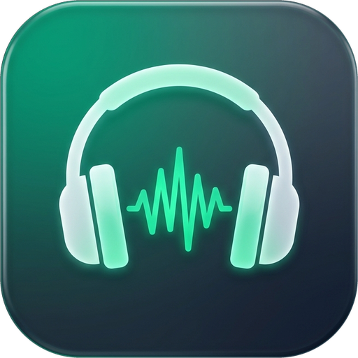

<div align="center">
  
  <h1>AlgerMusicPlayer · WinUI 3</h1>
  <p>A Native Windows Hi-Res Music Player Rebuilt from Scratch with C# / .NET 9 &amp; WinUI 3</p>

  <p>
    <a href="./README.md">简体中文</a> | <strong>English</strong>
  </p>

  <p>
    <a href="https://github.com/TencenTiM/AlgerMusicPlayer-WinUI3/stargazers"></a>
    <a href="https://github.com/TencenTiM/AlgerMusicPlayer-WinUI3/releases"></a>
    
    
    
    
    <a href="./LICENSE"></a>
  </p>
</div>

---

## 📖 Overview

**AlgerMusicPlayer (WinUI 3 Edition)** is a **100% pure native C# / WinUI 3** desktop rewrite of the open-source music player **[algerkong/AlgerMusicPlayer](https://github.com/algerkong/AlgerMusicPlayer)**.

By completely eliminating the Electron (Chromium + Node.js) runtime overhead and rebuilding the entire network protocol stack, audio playback pipeline, and Fluent UI on **.NET 9 + Windows App SDK 1.6**, this edition preserves the beloved UX and feature set of the original project while delivering near-instant cold startup, minimal RAM/CPU footprint, native Windows 11 Mica backdrop materials, **24-bit Master / Hi-Res streaming**, and **non-downmixed 5.1 / 7.1 multichannel WASAPI output**.

---

## 📸 Screenshots

| Dark Mica Theme | Light Theme |
| :---: | :---: |
|  |  |
| **24-bit Master & Multi-Source Settings** | **Custom Single-File Native Installer** |
|  |  |

---

## ✨ Key Features

- **🪟 True Native Windows 11 Experience**
  - Built on WinUI 3 and Windows App SDK 1.6 with native Mica backdrop, seamless Dark/Light theme switching, floating Mini Player window, System Tray integration, and native Windows System Media Transport Controls (SMTC).
  - Global customizable hotkeys, plus automatic cross-session persistence for the currently playing track, exact playback position, and active local folder.

- **🎧 Audiophile Engine & True 5.1 Multichannel Passthrough**
  - Dual-backend audio pipeline (`NAudio` + bundled native `mpv` WASAPI backend) supporting **true 5.1 / 7.1 surround sound playback without software matrix downmixing (`--ad-lavc-downmix=no`)**.
  - Built-in 10-band parametric Equalizer (EQ) with multiple presets, variable playback speed, and customizable Sleep Timer.

- **🎼 Full Online Music Ecosystem & 24-bit Master Quality**
  - **Zero Node.js Dependency**: Pure C# implementation of NetEase Cloud Music WEAPI / EAPI encryption protocols directly in-process.
  - Supports QR Code login, passwordless UID login, and Cookie login; full support for Daily Recommendations, Personal FM, Intelligence Mode (HeartBeat), Playlist Square, New Albums, Top Charts, Podcasts/DJ Radios, Listening Rankings, and Song Comments.
  - **24-bit Master / Lossless Streaming & Multi-Source Unblocking**: Real-time quality badge and selector (Standard / 320k / Lossless FLAC / Hi-Res / **24-bit Master `jymaster`**), automatic multi-source lossless upgrading, per-song source switching, custom API endpoints, and LX Music script configuration.
  - **Cross-Platform Sources**: Native **QQ Music** account & playlist sync, **Bilibili** BV/keyword multi-part audio streaming, and **MV Video** browsing across 6 regions with 1080P/720P full-screen continuous playback.
  - **Lossless Batch Downloader**: Multi-threaded audio downloader powered by `TagLibSharp` with automatic cover art, metadata, and LRC lyrics embedding.

- **📂 Local Library & NAS / SMB Network Shares**
  - Recursive multi-folder scanning with native streaming support for LAN **SMB / UNC shared directories (`\\server\share`)**.
  - Dual library views featuring a hierarchical **Folder Tree** view and an all-songs flat list view with instant search and sorting.

- **🎤 Immersive Full-Screen Lyrics & Transparent Desktop Lyrics**
  - Click the bottom-left album cover to enter the immersive player view featuring dynamic album-color ambient gradients, interactive 3D cover art, synchronized LRC line-by-line / YRC word-by-word / translated / romanized lyrics, and lyric timing offset controls.
  - Standalone Win32 layered transparent Desktop Lyrics window with always-on-top, click-through lock, and customizable typography & colors.

- **📦 Custom Single-File Native Installer**
  - Includes a self-contained, zero-dependency installer project (`AlgerMusicPlayer.Installer`) that packages everything into a standalone `AlgerMusicPlayer-Setup-x64.exe` installer and a portable `.zip` archive, with full Unicode/CJK path support, shortcuts creation, and one-click clean uninstallation.

---

## 🗂️ Project Structure

```text
AlgerMusicPlayer-WinUI3/
├── AlgerMusicPlayer.WinUI/             # Main WinUI 3 Application (.NET 9 / Windows App SDK 1.6)
│   ├── Assets/                         # Application icons & static assets
│   ├── Helpers/                        # Win32 P/Invoke interop, windowing & system tray helpers
│   ├── Models/                         # Music, lyrics, settings & audio quality models
│   ├── Services/
│   │   ├── Api/                        # Pure C# NetEase WEAPI/EAPI, QQ Music & Bilibili clients
│   │   ├── Audio/                      # NAudio + mpv 5.1 native audio engine, 10-band EQ & SMTC
│   │   ├── Download/                   # Async download manager & TagLibSharp metadata writer
│   │   ├── Local/                      # Local/SMB scanner & hierarchical folder tree builder
│   │   ├── Lyric/                      # LRC / YRC word-by-word / translation / romaji parser
│   │   ├── System/                     # Persistent config, global hotkeys & i18n service
│   │   └── Unblock/                    # 24-bit Master / lossless multi-source matcher
│   ├── ViewModels/                     # MVVM MainViewModel (CommunityToolkit.Mvvm)
│   ├── Views/                          # MainWindow, Immersive Lyrics, MiniPlayer & DesktopLyricWindow
│   └── mpv/win-x64/                    # Bundled native multichannel audio backend (tracked via Git LFS)
├── AlgerMusicPlayer.Installer/         # Custom single-file native Setup & Uninstaller project
├── build_and_run.ps1                   # One-click dev build & launch script
├── build-installer.ps1                 # One-click self-contained Setup.exe & Portable ZIP builder
└── AlgerMusicPlayer.WinUI.sln          # Visual Studio Solution
```

---

## 🚀 Getting Started

### Prerequisites

- **OS**: Windows 10 (version 1809 / Build 17763+) or Windows 11 (x64)
- **SDK**: [.NET 9.0 SDK](https://dotnet.microsoft.com/download/dotnet/9.0) (or Visual Studio 2022 17.12+ with ".NET Desktop Development" and "Windows App SDK C# Templates")
- **Git LFS**: Required to pull the bundled `mpv.exe` binary

### 1. Clone the Repository

```powershell
git lfs install
git clone https://github.com/TencenTiM/AlgerMusicPlayer-WinUI3.git
cd AlgerMusicPlayer-WinUI3
```

### 2. Build & Run (Development)

Open `AlgerMusicPlayer.WinUI.sln` in Visual Studio (`x64`) and press `F5`, or run via PowerShell:

```powershell
powershell -ExecutionPolicy Bypass -File .\build_and_run.ps1
```

### 3. Build Standalone Installer & Portable Package

```powershell
powershell -ExecutionPolicy Bypass -File .\build-installer.ps1
```

Output artifacts will be generated under `dist/`:
- `dist/AlgerMusicPlayer-Setup-x64.exe` — Self-contained single-file installer (no .NET runtime installation required)
- `dist/AlgerMusicPlayer-Portable-x64.zip` — Portable archive

---

## 🙏 Acknowledgements

First and foremost, heartfelt thanks go to the original author **[Alger (@algerkong)](https://github.com/algerkong)** and the original open-source project **[algerkong/AlgerMusicPlayer](https://github.com/algerkong/AlgerMusicPlayer)**!

The original project set an outstanding benchmark for open-source music players with its rich feature set, thoughtful UI/UX design, and dedication to the community. The UI layout, interaction design, and product philosophy of this WinUI 3 native edition are directly inspired by and faithfully adapted from the original work. Huge respect and gratitude to **[@algerkong](https://github.com/algerkong)** and all contributors to the upstream project! Please consider visiting the original repository and giving it a Star ⭐️:
- Original Repository: [https://github.com/algerkong/AlgerMusicPlayer](https://github.com/algerkong/AlgerMusicPlayer)

Special thanks as well to the following open-source projects and communities:
- [Microsoft Windows App SDK / WinUI 3](https://github.com/microsoft/WindowsAppSDK)
- [CommunityToolkit.Mvvm](https://github.com/CommunityToolkit/dotnet)
- [NAudio](https://github.com/naudio/NAudio)
- [mpv media player](https://github.com/mpv-player/mpv)
- [TagLibSharp](https://github.com/mono/taglib-sharp)
- [QRCoder](https://github.com/codebude/QRCoder)
- [Binaryify/NeteaseCloudMusicApi](https://github.com/Binaryify/NeteaseCloudMusicApi)

---

## ⚠️ Disclaimer

1. This software is intended strictly for **educational, technical research, and personal non-commercial use** in learning C# / .NET / WinUI 3 desktop development. Commercial use is strictly prohibited.
2. This project does not host, store, or distribute any copyrighted audio or video files. All online streams are resolved on-the-fly from publicly accessible interfaces, and all copyrights belong to their respective platforms and rights holders.
3. Please support artists and copyright holders by subscribing to official music streaming services.

---

## 📄 License

This project is licensed under the **[MIT License](./LICENSE)**, continuing the open-source spirit of the original project (bundled `mpv` components remain governed by their respective upstream licenses; see `AlgerMusicPlayer.WinUI/mpv/win-x64/LICENSE.GPL`).
